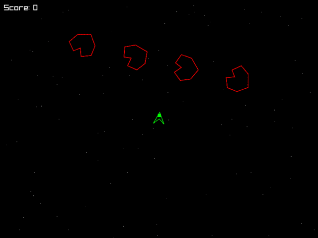

# Malvado

**Small scripts. Living worlds.**

Malvado is an open-source game engine for making 2D games with **Lua or C**. Inspired by **DIV Games Studio**, it brings process-based game development to a lightweight engine built with C and raylib.

The idea is simple: give each character, object, or effect its own behavior, then let those little pieces create something bigger together.

**[Documentation](https://jepemo.github.io/malvado/)** · **[Examples](examples/)** · **[Release plan](docs/versions/README.md)** · **[Future roadmap](docs/roadmap/README.md)**

> **Work in progress:** Malvado 2 is in active alpha development. The API and tools may change as the engine evolves.



*[Space Asteroids](examples/space_asteroids/), running in Malvado.*

## Hello, Malvado!

**Give it a shape. Give it a behavior. Let it run.**

In Malvado, a *process* is an independent piece of your game. It has its own state and can keep running from one frame to the next.

```lua
require("malvado").import_globals()

local Player = process(function(self)
  self.graph = circle(16, {color = {80, 190, 255}})

  while not key("escape") do
    if key("left") then self.x = self.x - 3 end
    if key("right") then self.x = self.x + 3 end
    frame()
  end
end)

start(function()
  clear_screen(25, 30, 45)
  Player {x = 160, y = 120}
end)
```

`process()` defines a behavior. `Player { ... }` creates an instance with its own state. `self.graph` gives it a visible shape, and `frame()` lets other processes run before continuing.

Move with **Left** and **Right**. Press **Escape** to exit.

## Give it a try

You'll need [Git](https://git-scm.com/), [mise](https://mise.jdx.dev/), and a C compiler. On Linux, you also need the X11 and OpenGL development packages listed in the [CI configuration](.github/workflows/ci.yml).

```sh
git clone https://github.com/jepemo/malvado.git
cd malvado
mise install
mise run hello
```

The first build downloads pinned dependencies. The example opens a window; press **Escape** to close it.

Want to start your own project? Install the development SDK locally:

```sh
mise run install
export PATH="$HOME/.local/share/malvado-dev/bin:$PATH"
malvado new my-game
cd my-game
malvado run
```

See the [SDK guide](docs/site/sdk.md) for more details, including C projects and exporting games on the current host.

## Explore

Malvado already includes:

- **Processes with personality.** Give each instance its own state, timing, and lifecycle.
- **A native core.** The scheduler and engine live in C, with a public C API that does not require Lua.
- **Lua for quick ideas.** Write game behavior with small scripts and a bundled Lua runtime.
- **The essentials for 2D.** Graphics, sprites, text, input, and runnable examples.
- **Tools to get started.** Create, run, and export projects using the `malvado` command on supported development hosts.

Try the [Space Asteroids example](examples/space_asteroids/), browse the [other examples](examples/), or read the [documentation](https://jepemo.github.io/malvado/).

## What's next?

The current focus is completing C/Lua/Rust integration and CLI workflows, then validating the existing engine on supported platforms for 2.0. Future API families, graphics modes and editor work are proposals in the [future roadmap](docs/roadmap/README.md).

Follow the [version plan](docs/versions/README.md) to see what's implemented and what's still planned.

## Come build with us

Malvado is a personal open-source project, and curiosity is welcome. If you try it, find a bug, have an idea, or want to contribute, [open an issue](https://github.com/jepemo/malvado/issues).

Licensed under [Apache 2.0](LICENSE).
