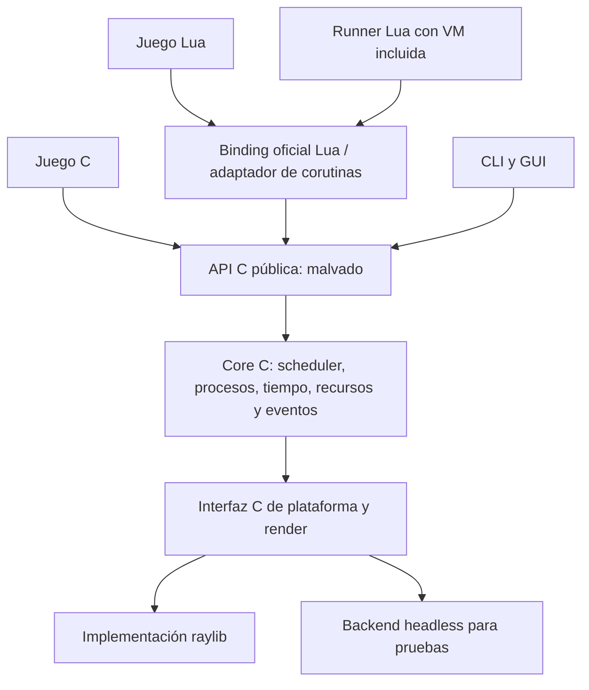

# Arquitectura C y binding Lua oficial

Estado: decisión de arquitectura y plan de refactorización, todavía no implementados. Esta decisión amplía y precisa el [roadmap](../planning/roadmap.md). Un juego debe poder utilizar Malvado directamente desde C; Lua es el binding oficial incluido en el repositorio y soportado al mismo nivel de calidad.

## Situación real

`malvado_core` contiene actualmente un contexto C opaco, reloj y orden de ejecución, pero `src/runner/runtime.c` reúne el estado global del motor, procesos, colas, ciclo de vida, `lua_State`, corutinas, dibujo raylib y funciones Lua. `malvado-run` enlaza Lua y raylib. `include/malvado/malvado.h` expone el contexto y reloj C iniciales; `runtime.h` ofrece hooks de diagnóstico. Todavía no existe una API C de procesos o de juego completo. Las pruebas y ejemplos existentes ejercitan principalmente Lua. Por tanto, las frases anteriores que describían un core independiente eran **objetivos**, no características ya disponibles. Los avances actuales son útiles como referencia y pruebas de regresión, pero no cierran esta decisión.

## Capas y dependencias



**Reglas verificables:** `include/malvado/` y `src/core/` no incluyen Lua ni tipos `lua_State`, ni dependen de Lua en compilación/enlace. Cabeceras públicas tampoco incluyen `raylib.h`: raylib está en su adaptador de plataforma. El núcleo debe poder configurarse, compilarse y probarse sin descargar, encontrar ni enlazar Lua o raylib con backend headless. El producto completo de escritorio utiliza raylib; el runner oficial enlaza Lua embebido fijado. Una prueba real de un juego C sin Lua garantiza que esta separación no sea solo de nombres.

Capas previstas:

- **API C:** cabeceras instalables, contexto opaco, identificadores y errores. Facilita juegos C y otras integraciones.
- **Core C:** un único scheduler, estados y árbol de procesos, reloj, colas y operaciones de juego. No conoce ni llama a Lua.
- **Backend:** interfaz interna C; implementación raylib para ventana/dibujo/entrada/audio y backend headless para pruebas. El core no necesita contexto GPU para sus pruebas.
- **Binding Lua oficial:** un módulo C traduce la API Lua, crea y conserva corutinas Lua y llama al core. Ownership, errores y cleanup Lua quedan en esta capa.
- **Runner:** programa opcional que crea VM, registra binding y ejecuta el juego Lua. Juegos puramente C enlazan core + backend sin runner ni VM.

## Modelo de proceso C

El core controla los procesos y su ciclo de vida con callbacks C y estado explícito. El callback de un proceso es invocado por el scheduler hasta que solicita ceder, dormir o terminar. **Un callback C retorna al scheduler**; no se promete suspender la pila C ni guardar sus variables locales automáticamente. El juego conserva su estado en memoria asociada al proceso; su destructor se llama una sola vez en terminación normal, señal, error o cierre de contexto.

Propuesta de forma, **ilustrativa y no implementada**:

```c
/* Nombres y firmas por concretar al implementar la API pública. */
typedef struct { int x; } EnemyState;

static MvStepResult enemy_step(MvContext *ctx, MvProcessId id, void *data)
{
    EnemyState *enemy = data;
    enemy->x += 1;
    mv_process_set_position(ctx, id, enemy->x, 100);
    return MV_STEP_YIELD;
}

/* El contexto posee el scheduler; la política de ownership del estado se
   especificará en el descriptor del proceso antes de estabilizar la API. */
```

`MV_STEP_YIELD`, suspensión, muerte, prioridad, árbol y orden se expresan en términos del core. El callback se invoca una vez por activación; procesos creados durante un tick empiezan el siguiente. La política de error C debe ser explícita, sin `longjmp` del binding a través del core. El ejemplo anterior no es una cabecera real ni promete que los nombres definitivos coincidan.

## Lua sobre ese mismo scheduler

Una instancia Lua es un proceso del core cuyo callback de adaptación reanuda una coroutine de la **misma VM del host**. El binding guarda la referencia de registry y la libera en su callback de destrucción; `frame()` cede la coroutine Lua y el callback devuelve el resultado equivalente al core. La eliminación diferida evita cerrar la coroutine mientras se ejecuta. Se conserva `process(function(self) ... frame() end)`; ningún segundo scheduler Lua repite el control del ciclo de vida.

C y Lua pueden coexistir en un mismo contexto cuando el runner incluya el binding. Eventos, árbol, prioridades, señales y tick son compartidos. Los mensajes entre C y Lua necesitan un contrato explícito de valores y ownership: para la API común, definir valores nativos/serializables con copia o referencia gestionada; las referencias a objetos Lua actuales deben permanecer encapsuladas y liberadas por el binding, y su comportamiento compartido dentro de Lua debe cubrirse con pruebas de regresión. No meter `lua_State*` ni referencias de registry en structs o colas del core. Decidir si los valores Lua no convertibles tienen una vía local separada; no prometer intercambio C/Lua de tablas arbitrarias antes de diseñarlo.

`self` debe representar un proceso del core sin que campos como identidad, estado, padre o prioridad puedan falsificar sus valores. Las propiedades particulares del juego Lua permanecen en una tabla de usuario del binding. Definir explícitamente vida de handles, detección de procesos eliminados y errores en ambos lenguajes.

## API C, ownership y ABI

Introducir `include/malvado/malvado.h` y cabeceras por módulo cuando exista código real. Las APIs C y Lua tendrán referencia y ejemplos ejecutables según el [plan de documentación](../development/api-documentation.md). `MvContext` y recursos son opacos; IDs y valores públicos tienen tipos de ancho especificado. Documentar en cada función entradas, unidades, retornos, errores, duración de punteros, propiedad y destrucción. Gestionar texto/recursos/ventana desde el contexto, evitando singleton global para permitir crear, cerrar y volver a crear un contexto en pruebas.

Empezar con biblioteca estática C y API fuente versionada; biblioteca compartida y estabilidad ABI se definen explícitamente antes de prometerlas. Funciones retornan códigos de error o resultados verificables; el binding los convierte en errores Lua. Las callbacks de C no deben recibir punteros a estructuras internas. El contexto se usa desde su hilo propietario; workers e IPC requieren diseño separado.

## Build, juegos y herramientas

Propuesta de targets CMake:

| Target | Propósito | Dependencias |
| --- | --- | --- |
| `malvado_core` | Scheduler y APIs del motor | C/stdlib; sin Lua, sin raylib |
| `malvado_platform_headless` | Reloj/entrada/dibujo simulados para pruebas | C/stdlib |
| `malvado_platform_raylib` | Plataforma de escritorio/juego | raylib |
| `malvado_lua_binding` | Binding oficial, incluida coroutine Lua | core + Lua |
| `malvado-run` | Ejecutable de juegos Lua con VM incluida | core + binding + backend |
| `example-c-game` | Juego ejecutable escrito en C | core + backend; sin Lua |

Opciones de configuración deben permitir `MALVADO_BUILD_LUA=OFF`, `MALVADO_BUILD_RAYLIB=OFF` y pruebas headless sin descargar dependencias de ambos; nombres exactos por confirmar durante implementación. CMake debe declarar y descargar Lua/raylib solo si el target habilitado lo requiere; `build/_deps` sigue ignorado. Al instalar, distribuir cabeceras y librerías con licencias y reglas de link transitivas documentadas.

CLI/GUI reutilizan servicios C. Para proyectos Lua, `run/export` empaqueta runner y scripts. Para juegos C, el CLI podrá generar y compilar un proyecto nativo contra el SDK para el destino, con toolchain apropiado; eso es trabajo adicional de alpha.4/alpha.6, no una capacidad de exportación ya existente. Android necesita entrada/lifecycle, NDK y SDK para ambos caminos. El módulo opcional LuaRocks usa el Lua del host con ABI compatible; no debe insertar una VM Lua adicional en el core.

## Migración incremental y aceptación

1. **Corte 1, iniciado:** contexto C independiente y reloj con build sin Lua ni raylib y [ejemplo C](../../examples/c/clock/README.md). Aún faltan loop completo, backend headless y juego C de verdad; mantener runner existente mientras se compara.
2. **Corte 2:** trasladar al core scheduler, tipos, IDs, árboles, prioridades y señales; proceso C con estado/callback/destructor. Probar `kill`, `kill_tree`, sleep/freeze/wakeup, creación durante tick, errores y cierre. El core debe liberar estado sin fugas.
3. **Corte 3:** extraer el binding Lua y corutinas; conectar al scheduler C único. Ejecutar todas las pruebas Lua ya existentes y pruebas mixtas C/Lua de orden, mensajes, señales y cleanup. Preservar el comportamiento documentado o documentar y aprobar una migración explícita.
4. **Corte 4:** mover recursos/dibujo y diagnósticos al core/adaptador; separar plataforma raylib; conservar freeze/sleep visual con capturas. Añadir backend headless y ejemplos equivalentes C/Lua, con contratos de ownership.
5. **Corte 5:** instalar SDK C, empaquetar runner oficial y verificar CI, exportadores y documentación por plataforma. LuaRocks externo se verifica por separado cuando exista target de módulo.

Para cada corte: ejecutar tests existentes antes y después, tests C independientes y sanitizers; no borrar ni desactivar el runner de trabajo hasta demostrar paridad. Pruebas headless en Linux/macOS durante alphas 1–5, smoke gráfico en plataformas disponibles y verificaciones de build sin Lua. Añadir Windows y verificar sus recorridos completos en alpha.6 antes de beta. Publicar un ejemplo completo C junto a su equivalente Lua y ejecutar ambos en CI. La ruta sin Lua es un criterio de aceptación, no una variante experimental que se pueda romper sin detectarlo.
