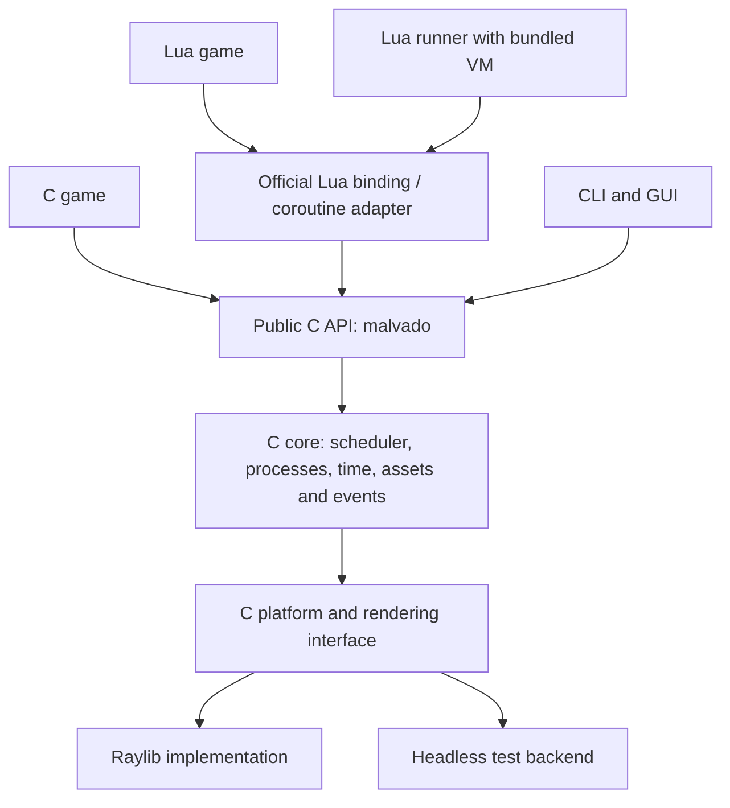

# C architecture and official Lua binding

Status: C core, Lua binding, and backends are separate and under validation. This decision extends and clarifies the [roadmap](../planning/roadmap.md). A game must be able to use Malvado directly from C. Lua is the official in-repository binding and receives the same level of support.

## Current state

`malvado_core` has an opaque C context, clock, scheduler, and process queues. `src/binding/runtime.c` adapts Lua coroutines to the scheduler and retains Lua references. `src/platform/` implements the raylib and headless backends. The runner links the binding. `include/malvado/malvado.h` exposes the initial C operations. `runtime.h` provides diagnostic hooks. CTest includes C, Lua, and mixed tests, plus a C window example. The API and current changes remain under validation.

## Layers and dependencies



**Verifiable rules:** `include/malvado/` and `src/core/` do not include Lua or `lua_State` types and do not depend on Lua for build/link. Public headers do not include `raylib.h`; raylib is in its platform adapter. The core must configure, build, and test headless without downloading, finding, or linking Lua or raylib. The full desktop product uses raylib; the official runner links pinned bundled Lua. A real C game without Lua ensures that the separation is more than names.

Planned layers:

- **C API:** installable headers, opaque context, IDs, and errors for C games and integrations.
- **C core:** one scheduler, process states and tree, clock, queues, and game operations. It does not know or call Lua.
- **Backend:** internal C interface, raylib implementation for window/drawing/input/audio, and headless test backend. Core tests do not need a GPU context.
- **Official Lua binding:** C module that translates the Lua API, creates and retains Lua coroutines, and calls the core. Lua ownership, errors, and cleanup stay in this layer.
- **Runner:** optional program that creates the VM, registers the binding, and runs the Lua game. C-only games link the core and backend without the runner or VM.

## C process model

The core controls process lifecycle with C callbacks and explicit state. The scheduler invokes a process callback until it yields, sleeps, or ends. **A C callback returns to the scheduler**. It does not promise to suspend the C stack or automatically retain local variables. The game stores state in process-associated memory. Its destructor runs once on normal termination, signal, error, or context shutdown.

Illustrative proposal, **not implemented as shown**:

```c
/* Names and signatures must be fixed during API implementation. */
typedef struct { int x; } EnemyState;

static MvStepResult enemy_step(MvContext *ctx, MvProcessId id, void *data)
{
    EnemyState *enemy = data;
    enemy->x += 1;
    mv_process_set_position(ctx, id, enemy->x, 100);
    return MV_STEP_YIELD;
}

/* The context owns the scheduler. Define state ownership in the process
   descriptor before the API is stabilized. */
```

`MV_STEP_YIELD`, suspension, termination, priority, tree, and order are expressed in core terms. The callback runs once per activation. A process created during a tick starts on the next tick. The C error policy must be explicit, without a binding `longjmp` through the core. The example is not a public header and does not promise final names.

## Lua on the same scheduler

A Lua instance is a core process. Its adapter callback resumes a coroutine in the **same host VM**. The binding holds a registry reference and releases it in its destruction callback. `frame()` yields the Lua coroutine and the adapter returns the equivalent result to the core. Deferred removal prevents closing a running coroutine. Keep `process(function(self) ... frame() end)`. A second Lua scheduler must not duplicate lifecycle control.

C and Lua can share a context when the runner includes the binding. Tree, priorities, signals, tick, and queues are shared. Both languages can exchange booleans, integers, numbers, and binary strings. Strings are copied. The core stores opaque values with a generic destructor. The binding encapsulates Lua references and sends non-primitive objects only to Lua processes. C receive transfers the message to the caller, who must call `mv_message_release`. An opaque send transfers ownership only on success. Lua tables retain shared identity within Lua.

`self` must represent a core process without allowing fields such as identity, state, parent, or priority to falsify their values. Lua game properties remain in a binding user table. Define handle lifetimes, detection of deleted processes, and errors in both languages.

## C API, ownership, and ABI

Introduce `include/malvado/malvado.h` and module headers as code exists. The C and Lua APIs have references and runnable examples according to the [documentation plan](../development/api-documentation.md). `MvContext` and resources are opaque. Public IDs and values use specified-width types. Document inputs, units, returns, errors, pointer lifetimes, ownership, and destruction for each function. Manage text/resources/window through the context. Avoid a global singleton so tests can create, close, and recreate a context.

Start with a static C library and versioned source API. Define a shared library and ABI stability before promising either. Functions return error codes or checkable results; the binding converts them to Lua errors. C callbacks must not receive pointers to internal structures. Use the context on its owner thread. Workers and IPC need separate designs.

## Build, games, and tools

Proposed CMake targets:

| Target | Purpose | Dependencies |
| --- | --- | --- |
| `malvado_core` | Scheduler and engine APIs | C/stdlib; no Lua or raylib |
| `malvado_platform_headless` | Simulated clock/input/drawing for tests | C/stdlib |
| `malvado_platform_raylib` | Desktop/game platform | raylib |
| `malvado_lua_binding` | Official binding, including Lua coroutines | core + Lua |
| `malvado-run` | Lua game executable with bundled VM | core + binding + backend |
| `example-c-game` | Runnable C game | core + backend; no Lua |

Configuration must permit `MALVADO_BUILD_LUA=OFF`, `MALVADO_BUILD_RAYLIB=OFF`, and headless tests without downloading either dependency. CMake declares and downloads Lua/raylib only for enabled targets that require them. `build/_deps` remains ignored. Installation must distribute headers and libraries with licenses and documented transitive link rules.

CLI/GUI reuse C services. For Lua projects, `run/export` packages runner and scripts. For C games, the CLI may generate and build a native project against the target SDK with the proper toolchain. This is additional alpha.4/alpha.6 work, not an existing export capability. Android needs input/lifecycle, NDK, and SDK for both paths. The optional external LuaRocks module uses the host Lua with a compatible ABI. It must not insert an additional Lua VM into the core.

## Incremental migration and acceptance

1. **Cut 1:** independent C context, clock, headless backend, and C [process](../../examples/c/processes/README.md) and [window](../../examples/c/window/README.md) examples.
2. **Cut 2:** C scheduler with IDs, trees, priorities, signals, messages, callbacks, and destructors.
3. **Cut 3:** Lua coroutines use the C scheduler. A mixed test covers messages, signals, and priorities. The binding has a separate target.
4. **Cut 4, partial:** raylib and headless backends are separate, with a freeze/sleep visual test. Remaining resources and drawing belong to alpha.3. Lua diagnostics still live in the binding.
5. **Cut 5:** install the C SDK, package the official runner, and validate CI, exporters, and platform documentation. Verify external LuaRocks separately when a module target exists.

For each cut, run existing tests before and after, independent C tests, and sanitizers. Do not remove or disable the working runner until parity is demonstrated. Run headless tests on Linux/macOS during alphas 1–5 and graphics smoke tests on available platforms. Add Windows and verify full flows in alpha.6 before beta. Publish a complete C example with its Lua equivalent and run both in CI. The no-Lua path is an acceptance criterion, not an experimental variant that can silently break.
