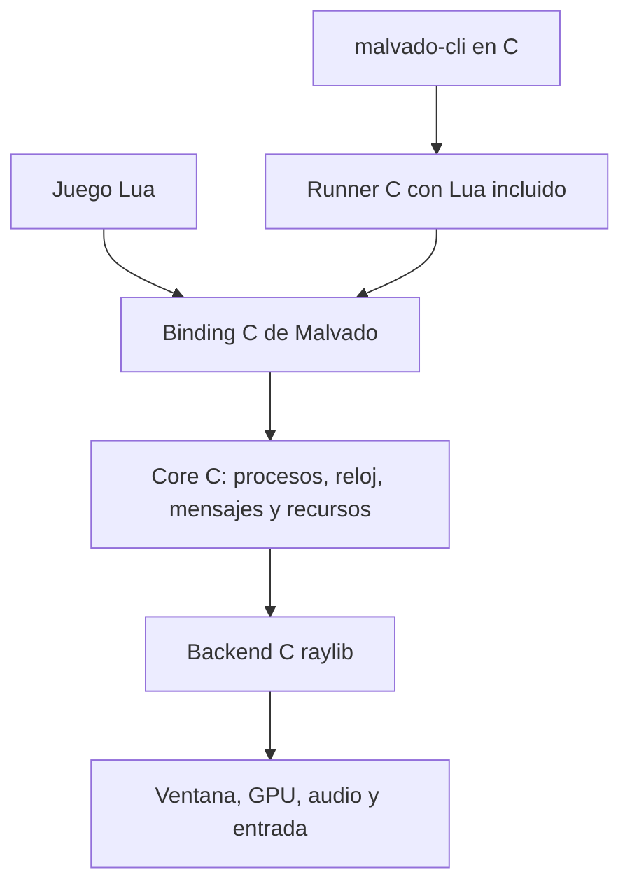

# Runtime C, raylib y Lua embebido

Estado: diseño propuesto; la decisión vinculante es [core C independiente y binding Lua oficial](c-first.md). El avance implementado de procesos e inspección se describe en [alpha.2](../versions/2.0.0-alpha.2.md). El manual oficial describe cómo [integrar Lua en C](https://www.lua.org/manual/5.4/manual.html#4) y [manejar yields desde C](https://www.lua.org/manual/5.4/manual.html#4.5). La [cabecera y módulos de raylib](https://github.com/raysan5/raylib) son la referencia del backend; hay que fijar una revisión antes de implementar.

## Responsabilidades



El core define ownership, datos, módulos y scheduler. El adaptador raylib dibuja, captura entrada y sirve audio. El binding valida argumentos, transforma errores y expone userdata. La capa Lua se limita al DSL, importaciones y aliases. Usar `math`/`string` de Lua cuando cumplan el contrato; ya son bibliotecas C y duplicarlas no aporta rendimiento.

## Corutinas: gestión C, continuación Lua

Un proceso script tiene un `lua_State *` creado por `lua_newthread`, con una referencia fuerte de registry (`luaL_ref`) para que no lo recoja el GC. Todos los procesos comparten una VM; no un `luaL_newstate` por proceso. La función script y su `self` se preparan en la pila de esa coroutine. Solo se pasa `self` en el primer `lua_resume`; las reanudaciones siguientes siguen el protocolo definido para `frame`.

Cada tick el scheduler C seleccionará procesos ejecutables y llamará a su callback; para procesos Lua ese callback del binding llamará a `lua_resume`. En la implementación actual `runtime.c` realiza ambas tareas y debe separarse. `LUA_YIELD` indica suspensión, `LUA_OK` terminación, otros resultados error con traceback. Limpiar valores producidos según `nresults` para no acumular pila. No reanudar corutinas muertas.

`frame()` será una función C breve: valida que la llamada esté dentro de un proceso yieldable, fija su próxima activación y llama a `lua_yield`/`lua_yieldk`. Si una función C necesita continuar trabajo después de una llamada Lua que puede ceder, usar `lua_callk`/`lua_pcallk` y continuaciones; no esperar que un yield conserve variables locales de C ni suspender a través de APIs C no yieldables. Una función nativa normal termina durante el tick o guarda su estado para el siguiente.

Esquema ilustrativo para **Lua 5.4**, no código listo para compilar:

```c
/* Primera activación: función y self ya preparados; luego nargs = 0. */
int nresults = 0;
int status = lua_resume(proc->thread, host_lua, first_run ? 1 : 0, &nresults);
switch (status) {
case LUA_YIELD: /* extraer resultados y dejarlo suspendido */ break;
case LUA_OK:    /* encolar destrucción */ break;
default:       /* traceback, error de proceso y salida según política */ break;
}
```

`lua_newthread` no crea un hilo del sistema. Render y VM se ejecutan en un mismo hilo. En el futuro, workers para carga/cálculos solo intercambian resultados con el hilo principal; no acceden concurrentemente al mismo estado Lua ni a la GPU.

## Datos y ciclo de vida

`MvContext` posee scheduler, pools y recursos. `MvProcess` contiene handle (slot + generación), tipo, padre/hijos, estado, prioridad, tick previsto, transform y referencia del script. `self` será userdata con `__index`/`__newindex` que accede a C. Propiedades extra del juego viven en una uservalue table por instancia, evitando un coste nativo para cada campo arbitrario.

Los handles caben en el entero de la versión Lua elegida; comprobar tamaños al compilar y evitar conversión por double. Acceder a un handle eliminado devuelve el error documentado, aunque el slot se haya reutilizado. PID y handles de recursos tienen tipos diferentes. Campos de motor de solo lectura: `id`, relación familiar y estado. Política de nombres reservados documentada.

Los mensajes se implementan como colas C. Payloads Lua se mantienen por registry hasta su recepción/descarte; el contrato inicial entrega referencias compartidas dentro de la VM, no copias profundas. Documentar límites y backpressure. Una futura API nativa de mensajes solo puede usar payloads C definidos, sin exponer objetos Lua al core.

Destruir un proceso no equivale a esperar al GC. Marcar, quitar del scheduler/dibujo y liberar sus referencias en un punto seguro; usar `lua_resetthread` para cerrar variables to-be-closed si se adopta Lua 5.4, revisar errores de cierre y después liberar la referencia de registry. El dibujo termina antes de descargar texturas. Los recursos compartidos se liberan explícitamente o al cerrar contexto; matar un proceso no borra recursos de otros.

## Contrato de scheduler propuesto

| Tema | Regla inicial |
| --- | --- |
| Reloj | Tick lógico fijo configurable (60 Hz por defecto), render desacoplado |
| Orden | Prioridad documentada y desempate por orden de creación; `z` solo afecta al dibujo |
| Alta durante tick | Proceso nuevo empieza en el siguiente tick; el PID se devuelve inmediatamente |
| `frame()` | Ceder hasta el tick siguiente; solo válido dentro de un proceso |
| Legacy `self.fps` | Cadencia por proceso con acumulador; no descartar remanente temporal |
| `frame(percent)` Bennu | Función del perfil de compatibilidad; especificar fracciones y múltiples reanudaciones con trazas antes de implementarla |
| Sleep | No ejecuta ni dibuja en el perfil Bennu propuesto; verificar referencia antes de etiquetar compatible |
| Freeze | No ejecuta, conserva dibujo; verificar colisiones y señales en referencia |
| Kill | Estado terminal y baja diferida; kill-tree explícito |
| Padre | Inferido desde proceso activo; elegir kill-tree legacy mediante perfil |
| Error Lua | Por defecto termina ejecución con traceback y salida no cero; modo de aislamiento opcional |
| Sin procesos de juego | Cierre ordenado después del tick, sin contar servicios internos |
| Proceso sin yield | Herramienta de diagnóstico con hook de instrucciones; por defecto error de presupuesto en desarrollo, no preempción transparente |

No inferir semántica histórica a partir del nombre de una función. `FRAME` es una construcción del lenguaje Bennu, no una función exportada de módulo. El comportamiento fraccionario y la ejecución inmediata de hijos deben medirse en el runtime de referencia y quedar separados de la política propuesta de Malvado.

Tick: capturar entrada → fijar lista de activaciones → reanudar → aplicar señales/bajas → actualizar animaciones/colisiones → construir cola de dibujo → dibujar → presentar. Un número máximo de pasos de recuperación evita un bucle sin fin tras una pausa larga; registrar tiempo descartado. Android reinicia acumuladores tras volver de background.

## Procesos escritos en C

Requisito de alpha.2: callback C con estado explícito; por ejemplo, `MvStepResult step(MvContext *, MvProcess *, void *state)` (firma orientativa). El callback devuelve `CONTINUE`, `SLEEP_UNTIL` o `DONE`; su estado lo posee el proceso. Es una máquina de estados explícita, sin corutinas portables en C11. Lua conserva la forma de escribir secuencias con `frame()`; no es necesario introducir fibras, `ucontext` o `setjmp` para esto.

## Implementación actual de observabilidad

El runner ofrece un hook C síncrono entre ticks, copia de estado, señales y pausa/paso. El hook de fotograma permite observar la imagen antes de presentarla. La API se utiliza y prueba dentro del mismo hilo; el protocolo IPC y la GUI siguen pendientes. El orden de ejecución ya vive en `src/core/schedule.c`, aunque el ciclo de vida de procesos y el binding siguen en el runner.

## Servicios de herramientas y observabilidad

[malvado-gui](../specs/gui.md) será un cliente opcional de servicios C compartidos con CLI. El core expone snapshots inmutables y comandos entre ticks, sin depender de ImGui ni del editor. Preparar esos puntos en P2; implementar protocolo local opt-in para G2. La GUI ejecuta el runner en un proceso separado, mantiene su propia ventana y captura errores sin bloquearse ante un juego que no ceda. Step avanza un tick de simulación, no una instrucción Lua. El IPC se versiona y su servidor de diagnóstico no se habilita por defecto en releases del juego.

Si se adopta Dear ImGui, sus dependencias C++ quedan en el target GUI detrás de interfaz C; core, CLI y exports siguen sin enlazarlas. No convertir el proyecto completo a C++ para integrar el toolkit.

## Render, formatos y pruebas

Transformaciones canónicas propuestas: grados, escala 1.0 y píxeles; en perfiles DIV/Bennu convertir miligrados y porcentajes. La API C no debe heredar accidentalmente unidades internas de raylib. Color RGBA 0–255 y alpha explícito; ancla de sprite definida, orden `z` y empates probado. Los textos persistentes y primitivas no son necesariamente llamadas de dibujo inmediato: distinguir ambas semánticas.

La [decisión detallada de assets](../specs/assets.md) distingue formatos, metadatos y contenedores: PNG+JSON editable, adaptadores FPG/Aseprite y ZIP para transporte. La importación FPG no implica exportación ni todas sus variantes; deben conservarse códigos y puntos estables.

Separar imagen CPU, textura GPU y colección de gráficos. PNG/spritesheet primero. FPG/MAP/FNT/PAL/FLI necesitan lectores o conversores propios; incluir puntos de control, palette/indexado y transparencias en el contrato. Colisión AABB de dos cajas primero y máscaras transformadas después, declarando diferencias.

Verificar core sin ventana: orden, altas/bajas, árboles, señales, memoria, errores y tiempos con reloj inyectado. Para backend: pruebas con ventana y capturas por plataforma, texturas, alpha, fuentes, audio y dispositivos. Usar sanitizers en plataformas compatibles, sin exigir igualdad bit a bit entre rasterizadores/GPU.
