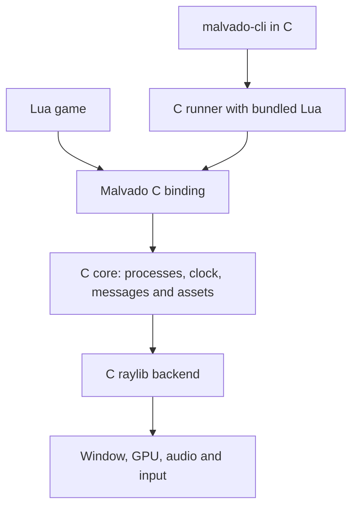

# C runtime, raylib, and bundled Lua

Status: proposed design. The binding decision is [independent C core and official Lua binding](c-first.md). See [alpha.2](../versions/2.0.0-alpha.2.md) for implemented process and inspection work. The official Lua manual describes [embedding Lua in C](https://www.lua.org/manual/5.4/manual.html#4) and [handling yields from C](https://www.lua.org/manual/5.4/manual.html#4.5). The [raylib headers and modules](https://github.com/raysan5/raylib) are the backend reference; pin a revision before implementation.

## Responsibilities



The core defines ownership, data, modules, and scheduler. The raylib adapter draws, captures input, and provides audio. The binding validates arguments, transforms errors, and exposes userdata. The Lua layer is limited to the DSL, imports, and aliases. Use Lua `math`/`string` when they meet the contract. They are already C libraries; duplicating them does not improve performance.

## Coroutines: C management, Lua continuation

A script process has a `lua_State *` created by `lua_newthread`, with a strong registry reference (`luaL_ref`) so GC does not collect it. All processes share one VM, not one `luaL_newstate` per process. Prepare the script function and `self` on the coroutine stack. Pass `self` only on the first `lua_resume`; later resumptions follow the `frame` protocol.

On each tick, the C scheduler selects runnable processes and calls their callback. For Lua processes, the binding callback calls `lua_resume`. `LUA_YIELD` means suspension, `LUA_OK` means completion, and other results produce an error with traceback. Remove produced values according to `nresults` to avoid stack accumulation. Do not resume dead coroutines.

`frame()` is a short C function: validate that it is called inside a yieldable process, set the next activation, and call `lua_yield`/`lua_yieldk`. If a C function must continue after a Lua call that can yield, use `lua_callk`/`lua_pcallk` and continuations. Do not expect a yield to retain C local variables or suspend through non-yieldable C APIs. A normal native function finishes during the tick or stores its state for the next one.

Illustrative **Lua 5.4** sketch, not ready-to-compile code:

```c
/* First activation: function and self are prepared; later nargs = 0. */
int nresults = 0;
int status = lua_resume(proc->thread, host_lua, first_run ? 1 : 0, &nresults);
switch (status) {
case LUA_YIELD: /* remove results and leave suspended */ break;
case LUA_OK:    /* queue destruction */ break;
default:       /* traceback, process error, and exit according to policy */ break;
}
```

`lua_newthread` does not create an operating-system thread. Render and VM run on the same thread. Future loading/calculation workers exchange results with the main thread. They do not access the same Lua state or GPU concurrently.

## Data and lifecycle

`MvContext` owns the scheduler, pools, and assets. The proposed `MvProcess` contains a handle (slot + generation), type, parent/children, state, priority, scheduled tick, transform, and script reference. `self` is userdata with `__index`/`__newindex` access to C. Extra game properties live in a per-instance uservalue table, avoiding native cost for each arbitrary field.

Handles must fit the integer type of the selected Lua version. Check sizes at build time and avoid conversion through double. Access to a deleted handle returns the documented error, even if the slot is reused. Process IDs and asset handles have different types. Engine identity, family relation, and status are read-only. Document the reserved-name policy.

Messages use C queues. Lua object payloads stay in the registry until receipt or discard. The initial contract uses shared references within the VM, not deep copies. Document limits and backpressure. The native message API uses defined C payloads and does not expose Lua objects to the core.

Destroying a process is not the same as waiting for GC. Mark it, remove it from scheduling/drawing, and release its references at a safe point. With Lua 5.4, use `lua_resetthread` to close to-be-closed variables, check close errors, then release the registry reference. Finish drawing before unloading textures. Release shared resources explicitly or at context shutdown; killing one process does not delete another process's resources.

## Proposed scheduler contract

| Topic | Initial rule |
| --- | --- |
| Clock | Configurable fixed logical tick (60 Hz by default); decoupled render |
| Order | Documented priority and creation-order tie break; `z` affects drawing only |
| Creation during tick | New process starts on the next tick; return PID immediately |
| `frame()` | Yield until the next tick; valid only inside a process |
| Legacy `self.fps` | Per-process cadence with accumulator; do not discard remaining time |
| Bennu `frame(percent)` | Compatibility-profile function; specify fractions and multiple resumptions with traces before implementation |
| Sleep | Does not execute or draw in the proposed Bennu profile; verify the reference before claiming compatibility |
| Freeze | Does not execute; keeps drawing. Verify collisions and signals against the reference |
| Kill | Terminal state and deferred removal; explicit kill-tree |
| Parent | Inferred from active process; choose legacy kill-tree through the profile |
| Lua error | By default, end execution with traceback and nonzero exit; optional isolation mode |
| No game processes | Orderly shutdown after the tick, excluding internal services |
| Process without yield | Diagnostic tool with instruction hook; development budget error by default, not transparent preemption |

Do not infer historical semantics from a function name. `FRAME` is a Bennu language construct, not a module export. Measure fractional behavior and immediate child execution in the reference runtime and keep them separate from proposed Malvado policy.

Tick sequence: capture input → fix activation list → resume → apply signals/removals → update animations/collisions → build draw queue → draw → present. A maximum catch-up count prevents an infinite loop after a long pause; record dropped time. Android resets accumulators after returning from the background.

## C processes

Alpha.2 requires a C callback with explicit state. For example, `MvStepResult step(MvContext *, MvProcess *, void *state)` is an illustrative signature. The callback returns `CONTINUE`, `SLEEP_UNTIL`, or `DONE`; the process owns its state. This is an explicit state machine, not portable C11 coroutines. Lua retains sequential code with `frame()`. Fibers, `ucontext`, or `setjmp` are not required for this.

## Current observability

The runner provides a synchronous C hook between ticks, state copies, signals, and pause/step. The frame hook can inspect the image before presentation. Use and test the API on the same thread. IPC and GUI remain pending. Scheduling and process lifecycle are in the C core; the binding is separate.

## Tool services and observability

[malvado-gui](../specs/gui.md) will be an optional client of C services shared with the CLI. The core exposes immutable snapshots and commands between ticks, without an ImGui or editor dependency. Prepare these points in P2. Implement an opt-in local protocol for G2. The GUI runs the runner in a separate process, keeps its own window, and captures errors without blocking on a game that does not yield. Step advances one simulation tick, not one Lua instruction. Version the IPC protocol; do not enable its diagnostic server by default in game releases.

If Dear ImGui is selected, keep C++ dependencies in the GUI target behind a C interface. Core, CLI, and exports do not link them. Do not convert the entire project to C++ for the toolkit.

## Rendering, formats, and tests

Proposed canonical transforms: degrees, scale 1.0, and pixels. Convert millidegrees and percentages in DIV/Bennu profiles. The C API must not accidentally inherit raylib internal units. Use RGBA 0–255 and explicit alpha. Define sprite anchors and test `z` order and ties. Persistent text and primitives are not necessarily immediate draw calls; distinguish the semantics.

The [asset decision](../specs/assets.md) separates formats, metadata, and containers: editable PNG+JSON, FPG/Aseprite adapters, and ZIP for transport. FPG import does not imply export or support for all variants. Preserve stable codes and points.

Separate CPU image, GPU texture, and graphics collection. Start with PNG/spritesheets. FPG/MAP/FNT/PAL/FLI need dedicated readers or converters. Include control points, palette/indexing, and transparency in the contract. Start with two-box AABB collision, then transformed masks, and declare differences.

Verify the core without a window: order, creation/removal, trees, signals, memory, errors, and timing with an injected clock. For the backend, test windows and captures per platform, textures, alpha, fonts, audio, and devices. Use sanitizers on compatible platforms. Do not require bit-identical rasterizer/GPU output.
