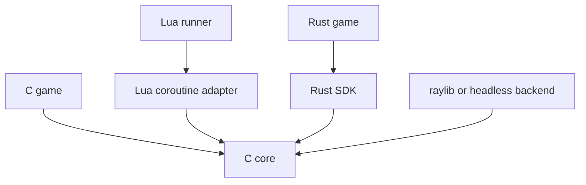

# Engine architecture

Malvado uses one native process scheduler for C, Lua and Rust. The
[public API reference](../api/README.md) describes the contracts each
language exposes.

## Repository layout

| Path | Responsibility |
| --- | --- |
| `src/core/` | Context, clock, process scheduling, lifecycle and shared data. |
| `src/include/malvado/` | Public C interfaces. |
| `src/platform/` | Window, drawing, input and audio implementations. |
| `bindings/lua/` | Bundled Lua integration and coroutine adapter, built by CMake. |
| `bindings/rust/` | Safe gameplay crate and raw FFI crate, built by Cargo. |
| `examples/` | Runnable games and teaching examples. |
| `tests/` | Engine, binding and exported-player verification. |

The C core builds and runs without Lua or raylib. The public headers keep
Lua and raylib types out of the engine interface. The asset component can
parse metadata without a graphics backend. The raylib adapter provides the
graphics and audio services used by graphical games.

## Process adapters

C hosts drive the context and keep state in callbacks. The [C process
contract](../api/c-contract.md) defines step results and cleanup. The Lua
runner drives the clock and rendering. Its adapter resumes a coroutine in
the game VM and keeps its registry reference until cleanup. See the
[Lua process guide](../api/lua-processes.md) and
[runner timing](../api/runner-timing.md).

Rust games own the context through `Game` and drive native ticks in their
host loop. Each process future owns its state. The adapter polls it when
the native scheduler activates that process. Native safe points determine
when cancellation drops the future. See [Rust processes](../api/rust-processes.md)
for wake behavior, cancellation and panic handling at the C boundary.

## Ownership and linking

Contexts, process references and graphics services have explicit owner
threads and lifetimes. See [process cleanup](../api/process-cleanup.md)
and [resource ownership](../api/resource-lifetime.md). The Rust raw crate
checks the native ABI and SDK version before use. The safe crate wraps
that boundary. See the [Rust SDK support policy](../api/rust-support.md)
and the [installed SDK guide](../site/sdk.md).

Keep behavior in the native implementation when it is shared by the three
languages. Document any difference in availability or semantics in the
[language matrix](../api/language-parity.md) and update the applicable
contracts and tests with the change.

## Verification

Use `mise run test-c` for the dependency-free core, `mise run test-headless`
for Lua without graphics and `mise run test-rust` for the installed Rust
consumer. Graphical checks and export verification are described in the
[CI guide](ci.md). Scope and acceptance history are in [versions](../versions/README.md).
