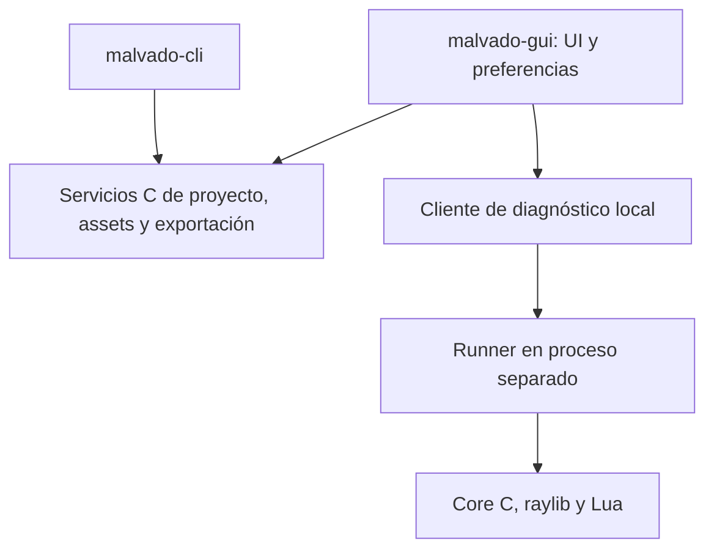

# malvado-gui: taller de proyectos, recursos y procesos

Estado: análisis y planificación; herramienta aún no implementada. Consulta de referencias: 2026-10-29.

## Propuesta de producto

Crear una aplicación de escritorio que ayude a **crear un proyecto, preparar sus gráficos, ejecutar el juego, entender sus procesos y exportarlo**. Ese recorrido aporta una identidad propia a Malvado. El proyecto continúa siendo una carpeta con Lua, configuración y assets, editable desde cualquier editor y utilizable íntegramente por CLI.

DIV integraba programación y utilidades para gráficos, paletas, mapas, paquetes FPG, fuentes y sonidos. Los [menús originales](https://github.com/DIVGAMES/DIV-Games-Studio/blob/77556912335d0a1b0efea855d4eb2490cf382128/system/lenguaje.div) documentan esa organización. Recuperar el acceso directo a recursos y a la ejecución, con el inspector de procesos como aportación específica. El alcance siguiente es una propuesta para Malvado, no una réplica histórica certificada de DIV.

## Comparación de alcances

| Enfoque | Valor | Coste y límite | Decisión propuesta |
| --- | --- | --- | --- |
| Launcher gráfico de CLI | Crear, ejecutar, comprobar y exportar fácilmente | Poco valor diferencial por sí solo | Primer incremento útil |
| Taller de recursos y procesos | Ver gráficos/animaciones y comprender el juego vivo | Necesita metadatos e instrumentación del core | Objetivo principal |
| IDE completo inspirado en DIV | Código, dibujo, sonido, niveles y debugger juntos | Editores y herramientas muy amplios que retrasan el motor | Fuera del primer alcance |

La primera versión debe poder demostrar el recorrido con starter y asteroides. La GUI será opcional para desarrollar y no se incluirá en los juegos exportados. Es aplicación para Linux/Windows/macOS; Android es un destino del juego, no un host inicial del editor.

## Funciones por prioridad

| Área | Primera entrega útil G1 | Siguiente G2/G3 | Posterior, según uso |
| --- | --- | --- | --- |
| Proyectos | Crear desde plantillas CLI, abrir carpeta, recientes, configurar ventana y perfil | Validaciones guiadas, recuperación de cambios | Catálogo remoto de plantillas |
| Código | Abrir editor externo, ir a archivo/línea desde un error | Buscar referencia API y ejemplos locales | Editor integrado con LuaLS y debugger de línea |
| Ejecución | Run/Stop/Restart, consola y traceback | Pause/Resume/Step tick e inspector | Preview incrustada y hot reload |
| Recursos | Lista, miniaturas PNG, atlas/spritesheet, dimensiones, preview de animación | Editar pivotes, puntos, rectángulos y duraciones; undo/redo | Máscaras y conversores FPG, según hito de formatos |
| Procesos | Diagnóstico y logs del runner | Árbol/lista con PID, tipo, padre, estado, x/y/z/angle, tiempos y mensajes pendientes | Inspección opt-in de datos Lua y snapshots comparados |
| Exportación | Destinos desktop, diagnóstico SDK, progreso, cancelar y abrir resultado | Android cuando el exportador CLI esté validado | Perfiles avanzados de distribución |
| Ejemplos | Abrir copia de starter/asteroids y controles | signals, timing, sprites y android-touch | Galería ampliada |

Un campo mostrado como runtime no se guarda automáticamente en el proyecto. En G2, inspector de solo lectura primero; una modificación en vivo futura será un comando explícito y temporal. Guardar propiedades de recursos en G3 sí modifica metadatos persistentes, con deshacer y guardado atómico.

No entran en G1/G2: editor general de escenas, lenguaje visual de nodos, pixel-art completo, compositor de audio, editor de niveles propio, breakpoints por línea, consola que ejecute Lua arbitrario o emulación completa del entorno DIV. Pintar sprites en Aseprite u otro editor y niveles en Tiled puede seguir siendo parte natural del flujo; el taller aporta integración y metadatos del motor.

## Disposición inicial

Una ventana: barra superior con proyecto y Run/Stop/Export; columna izquierda de archivos/recursos; centro con preview del recurso seleccionado; panel derecho de propiedades; consola inferior. En G2, pestaña Procesos con árbol/lista, propiedades y control de ticks. El juego corre inicialmente en su propia ventana, por lo que el preview central **no** promete un stream del juego.

G0/G1 puede usar paneles fijos y divisores. Docking dentro de una sola ventana si el prototipo lo valida. Ventanas desprendibles del sistema operativo quedan fuera del primer alcance: son distintas del docking y requieren soporte adicional de backend. Persistir layout y recientes como preferencias locales, fuera de los assets del juego. Controles de teclado, foco, DPI, texto UTF-8 y rutas con espacios forman parte de la aceptación.

## ¿Dear ImGui?

**Recomendación provisional: Dear ImGui para el taller de recursos y procesos**, detrás de un adaptador, con prototipo previo y una dependencia C++ acotada al ejecutable de herramientas. Su orientación a herramientas de desarrollo encaja con inspectores y datos que cambian cada tick; no proporciona por sí mismo el modelo de proyecto, undo, archivos ni depuración. El proyecto señala limitaciones de accesibilidad y composición/internacionalización de texto que hay que evaluar en el prototipo. [Fuente: Dear ImGui](https://github.com/ocornut/imgui).

| Opción | Lenguaje y dependencias | Adecuación a este alcance | Decisión |
| --- | --- | --- | --- |
| Dear ImGui + cimgui + adaptador raylib | Interfaz C; ImGui y wrapper se compilan con C++ | Buen candidato a inspector y múltiples paneles; integrar tres revisiones compatibles | Prototipo recomendado |
| Dear ImGui con capa UI pequeña en C++ y ABI C propia | UI/adaptador C++; servicios y core en C | Evita ampliar API de cimgui, pero más código propio en C++ | Alternativa de integración si simplifica mantenimiento |
| raygui | C, integrado con raylib | Buen candidato para launcher/formularios; evaluar coste de tablas, árboles y paneles complejos | Alternativa si C estricto es prioritario |

[cimgui](https://github.com/cimgui/cimgui) es un wrapper con API C sobre Dear ImGui: **no elimina C++ del build**. No exige cambiar el Lua del motor; fijar los ficheros generados evita introducir generación de bindings en cada build de usuario.

[rlImGui](https://github.com/raylib-extras/rlImGui/blob/main/README.md) integra raylib y Dear ImGui, ofrece interfaz utilizable desde C y usa C++ internamente; para widgets desde C requiere un wrapper como cimgui. La combinación es candidata, no una compatibilidad ya probada. Fijar juntos raylib, ImGui, cimgui y rlImGui, incluidas opciones de compilación.

[raygui](https://github.com/raysan5/raygui) ofrece controles inmediatos en C y está orientado a herramientas; sería la alternativa más directa si se decide evitar cualquier C++ en la GUI. No asumir equivalencia automática con un sistema de paneles acoplables ni construir una abstracción universal de widgets antes de necesitarla.

La [documentación oficial de docking](https://github.com/ocornut/imgui/wiki/Docking) explica cómo activarlo en la revisión correspondiente. Verificar la rama/revisión concreta al implementar; docking y multi-viewport no se habilitan por asumir que todo backend los soporta. Las dependencias gráficas de la GUI no se enlazan con runtime/CLI ni con los exports Android.

## Arquitectura compartida con CLI

Crear servicios C de proyecto/configuración, validación, assets, jobs y exportadores. CLI y GUI consumen estos servicios; ninguna regla de compilación, plantilla o empaquetado pertenece a un botón. Mantener `malvado.toml`, lockfile y metadatos como contrato común. No crear un formato de proyecto binario exclusivo de la GUI. Ver [assets y FPG](assets.md).

Esquema propuesto:

G1 lanza el runner como proceso separado y captura stdout/stderr, salida y errores; el editor continúa respondiendo si el juego falla o no cede. Stop solicita cierre y permite terminar únicamente el proceso hijo propio si no responde. Capturar errores estructurados sin depender solo del parseo de texto. Una preview incrustada futura necesitará resolver transferencia de imagen, foco, latencia y aislamiento; queda fuera de G1.

Los trabajos de exportación se ejecutan sin bloquear UI, con eventos de progreso y cancelación cooperativa. Los comandos de ejecución de herramientas usan argumentos estructurados, como en CLI. Si los servicios aún no ofrecen una ABI estable, un primer puente puede invocar CLI y consumir salida estructurada; no duplicar lógica ni interpretar mensajes localizados como protocolo.

## Instrumentación de procesos G2

Preparar en P2 del core una interfaz de snapshots y comandos ejecutados **entre ticks**, sin dependencia de ImGui. Implementar el canal cuando el runner/CLI estén disponibles. Protocolo versionado, local y opt-in mediante pipe/socket local exclusivo de la sesión, sin listener de red por defecto. Comprobar versión y capacidades al conectar; cerrar el canal al salir. La modalidad release exportada no activa diagnóstico por defecto.

Snapshot inmutable: tick, PID/generación, tipo, padre, estado, transform, próxima activación y métricas agregadas. Medir por separado duración de una reanudación Lua y un tick; no presentarlos como un profiler de instrucciones Lua. Contar mensajes sin copiar payloads; no serializar toda la VM ni ejecutar getters/metamétodos del juego para mostrar campos.

Pause detiene ticks, no la UI/entrada de control. Step avanza exactamente un tick lógico y publica el resultado; no es Step Into de Lua. El render puede seguir presentando el último estado, con política de audio documentada. Identificar snapshots y comandos por sesión/tick, detectar PID reutilizado y refrescar la selección si el proceso muere. No acceder a `lua_State` desde el hilo de UI ni permitir al inspector modificar estructuras C mientras corre un tick.

## Hitos y aceptación

| Hito de GUI | Dependencias | Entregable y puerta de salida |
| --- | --- | --- |
| G0 / decisión técnica | Core alpha.3 y recursos básicos | Prototipo comparativo pequeño: tabla/árbol, PNG/atlas, DPI, foco y build en macOS/Linux; elegir stack y fijar versiones. Windows se valida en alpha.6 si la GUI se distribuye |
| G1 / gui 0.1.0 | Core/CLI alpha.4 y G0 | Crear starter, abrir editor, ejecutar/reiniciar, error a archivo/línea, preview recursos y export desktop; mismo artefacto lógico que CLI |
| G2 / gui 0.2.0 | G1, core P2 instrumentado y protocolo validado | signals/timing: ver árbol y estados; pausa y un tick exacto; editor responde ante error/no-yield del juego |
| G3 / gui 0.3.0 | G2 y pipeline de assets validado | Editar puntos/pivotes/animaciones, undo/redo, guardar/reabrir; FPG import solo cuando lector tenga fixtures |
| G4 / gui 1.0.0 | Flujo de proyecto estable y soporte declarado | Recorrido crear→jugar→inspeccionar→exportar en hosts soportados; Android usa el exportador existente |

La GUI lleva versión propia porque es opcional y su madurez no debe fingir ser la del runtime 2.0. Añadir hooks de diagnóstico en el core temprano; la entrega GUI no bloquea estabilizar el motor/CLI. Android se muestra como destino cuando alpha.6 lo soporte. No hay fechas comprometidas ni fases entregadas.
