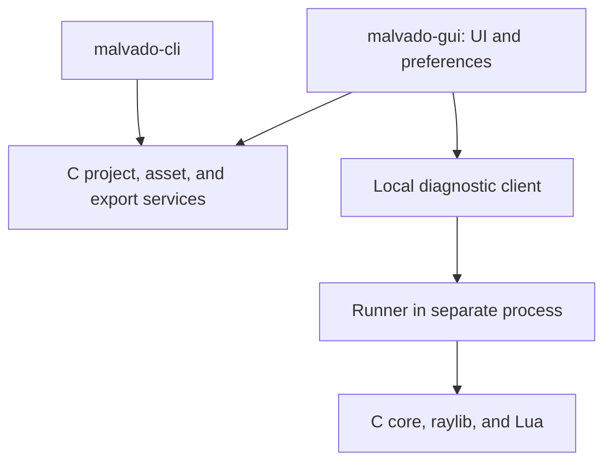

# malvado-gui: project, asset, and process workshop

Status: analysis and planning. The tool is not implemented. Reference research date: 2026-10-29.

## Product proposal

Create a desktop app that helps users **create a project, prepare graphics, run a game, understand its processes, and export it**. This flow gives Malvado a distinct identity. A project remains a folder with Lua, configuration, and assets. It can be edited in any editor and used entirely through the CLI.

DIV combined programming with graphics, palettes, maps, FPG packages, fonts, and sound utilities. The [original menus](https://github.com/DIVGAMES/DIV-Games-Studio/blob/77556912335d0a1b0efea855d4eb2490cf382128/system/lenguaje.div) document that organization. Restore direct access to assets and execution, with process inspection as a specific contribution. This scope is a Malvado proposal, not a certified historical DIV replica.

## Scope comparison

| Approach | Value | Cost and limit | Proposed decision |
| --- | --- | --- | --- |
| Graphical CLI launcher | Easy create, run, check, and export | Little unique value alone | Useful first increment |
| Asset and process workshop | View graphics/animations and understand the running game | Needs metadata and core instrumentation | Main goal |
| Full DIV-inspired IDE | Code, drawing, sound, levels, and debugger together | Large editors/tools delay the engine | Outside first scope |

The first version must demonstrate the flow with starter and asteroids. The GUI is optional for development and is not included in exported games. It runs on Linux/Windows/macOS. Android is a game target, not an initial editor host.

## Features by priority

| Area | First useful delivery G1 | Next G2/G3 | Later, based on use |
| --- | --- | --- | --- |
| Projects | Create from CLI templates, open folder, recent projects, configure window/profile | Guided validation, change recovery | Remote template catalog |
| Code | Open external editor; go to file/line from error | Search local API reference and examples | Integrated editor with LuaLS and line debugger |
| Execution | Run/Stop/Restart, console, traceback | Pause/Resume/Step tick and inspector | Embedded preview and hot reload |
| Assets | List, PNG thumbnails, atlas/spritesheet, dimensions, animation preview | Edit pivots, points, rectangles, durations; undo/redo | Masks and FPG converters according to format milestone |
| Processes | Runner diagnostics and logs | Tree/list with PID, type, parent, state, x/y/z/angle, timing, pending messages | Opt-in Lua data inspection and snapshot comparison |
| Export | Desktop targets, SDK diagnostics, progress, cancel, open result | Android after CLI exporter validation | Advanced distribution profiles |
| Examples | Open a copy of starter/asteroids and controls | signals, timing, sprites, android-touch | Expanded gallery |

A runtime field is not automatically saved to the project. In G2, make the inspector read-only first. A future live change is an explicit temporary command. Saving asset properties in G3 changes persistent metadata with undo and atomic saving.

G1/G2 exclude a general scene editor, visual node language, complete pixel-art editor, audio composer, custom level editor, line breakpoints, arbitrary Lua execution console, and full DIV environment emulation. Artists can use Aseprite or another sprite editor and Tiled for levels. The workshop adds integration and engine metadata.

## Initial layout

One window: top bar with project and Run/Stop/Export; left file/asset column; center preview of the selected asset; right properties panel; bottom console. In G2, add a Processes tab with tree/list, properties, and tick controls. The game initially runs in its own window. The center preview does **not** promise a game stream.

G0/G1 can use fixed panels and dividers. Add single-window docking if the prototype validates it. Detached OS windows are outside the first scope. They differ from docking and need extra backend support. Store layout and recent projects as local preferences outside game assets. Keyboard controls, focus, DPI, UTF-8 text, and paths with spaces are acceptance criteria.

## Dear ImGui?

**Provisional recommendation: Dear ImGui for the asset and process workshop**, behind an adapter, after a prototype, with C++ limited to the tool executable. Its development-tool focus suits inspectors and data that changes each tick. It does not itself provide the project model, undo, files, or debugging. The project notes accessibility and text composition/internationalization limits that the prototype must assess. [Source: Dear ImGui](https://github.com/ocornut/imgui).

| Option | Language and dependencies | Suitability | Decision |
| --- | --- | --- | --- |
| Dear ImGui + cimgui + raylib adapter | C interface; ImGui and wrapper compile as C++ | Good candidate for inspector and multiple panels; integrate three compatible revisions | Recommended prototype |
| Dear ImGui with small C++ UI layer and custom C ABI | C++ UI/adapter; C services/core | Avoids expanding cimgui API but adds custom C++ code | Integration alternative if maintenance is simpler |
| raygui | C, integrated with raylib | Good launcher/forms candidate; assess cost of tables, trees, and complex panels | Alternative if strict C is a priority |

[cimgui](https://github.com/cimgui/cimgui) is a C API wrapper over Dear ImGui. It **does not remove C++ from the build**. It does not require changing engine Lua. Pin generated files so users do not generate bindings on every build.

[rlImGui](https://github.com/raylib-extras/rlImGui/blob/main/README.md) integrates raylib and Dear ImGui, offers a C-usable interface, and uses C++ internally. C widgets need a wrapper such as cimgui. This combination is a candidate, not proven compatibility. Pin raylib, ImGui, cimgui, and rlImGui together, including build options.

[raygui](https://github.com/raysan5/raygui) provides immediate-mode C controls for tools. It is the most direct alternative if the GUI must avoid all C++. Do not assume it automatically matches a docking panel system or build a universal widget abstraction before it is needed.

The [official docking documentation](https://github.com/ocornut/imgui/wiki/Docking) explains how to enable it for the relevant revision. Check the exact branch/revision during implementation. Do not assume every backend supports docking and multi-viewport. GUI graphics dependencies do not link into runtime/CLI or Android exports.

## Architecture shared with CLI

Create C services for project/configuration, validation, assets, jobs, and exporters. CLI and GUI consume these services. Build rules, templates, and packaging logic do not belong in a button. Keep `malvado.toml`, lockfile, and metadata as a common contract. Do not create a GUI-only binary project format. See [assets and FPG](assets.md).

Proposed layout:

G1 launches the runner in a separate process and captures stdout/stderr, exit, and errors. The editor remains responsive if the game fails or does not yield. Stop requests shutdown and can terminate only its own child process if it does not respond. Capture structured errors; do not rely only on text parsing. A future embedded preview must solve image transfer, focus, latency, and isolation. It is outside G1.

Export jobs run without blocking the UI, with progress events and cooperative cancellation. Tool commands use structured arguments, as in the CLI. If services lack a stable ABI, an initial bridge can invoke the CLI and consume structured output. Do not duplicate logic or treat localized messages as a protocol.

## G2 process instrumentation

In core P2, prepare snapshots and commands executed **between ticks**, without an ImGui dependency. Implement the channel when runner/CLI are available. Use a versioned, local, opt-in protocol over a session-specific pipe/local socket, with no default network listener. Check version and capabilities on connection; close the channel on exit. Exported release mode does not enable diagnostics by default.

Immutable snapshot: tick, PID/generation, type, parent, state, transform, next activation, and aggregate metrics. Measure a Lua resume and a tick separately; do not present them as a Lua instruction profiler. Count messages without copying payloads. Do not serialize the whole VM or run game getters/metamethods to display fields.

Pause stops ticks, not UI/control input. Step advances exactly one logical tick and publishes the result; it is not Lua Step Into. Rendering may present the last state with a documented audio policy. Identify snapshots and commands by session/tick, detect reused PIDs, and refresh selection when a process dies. Do not access `lua_State` from the UI thread or let the inspector modify C structures during a tick.

## Milestones and acceptance

| GUI milestone | Dependencies | Delivery and exit gate |
| --- | --- | --- |
| G0 / technical decision | Core alpha.3 and basic assets | Small comparison prototype: table/tree, PNG/atlas, DPI, focus, macOS/Linux build; select stack and pin versions. Validate Windows in alpha.6 if GUI is distributed |
| G1 / gui 0.1.0 | Core/CLI alpha.4 and G0 | Create starter, open editor, run/restart, go from error to file/line, preview assets, desktop export; same logical artifact as CLI |
| G2 / gui 0.2.0 | G1, instrumented core P2, validated protocol | signals/timing: see tree/states; pause and exact one-tick step; editor responds to game error/no-yield |
| G3 / gui 0.3.0 | G2 and validated asset pipeline | Edit points/pivots/animations, undo/redo, save/reopen; FPG import only after reader fixtures exist |
| G4 / gui 1.0.0 | Stable project flow and declared support | Create→play→inspect→export on supported hosts; Android uses the existing exporter |

The GUI has its own version because it is optional. Its maturity must not imply runtime 2.0 maturity. Add core diagnostic hooks early. GUI delivery does not block engine/CLI stabilization. Show Android as a target when alpha.6 supports it. No dates are committed and no GUI phases are delivered.
